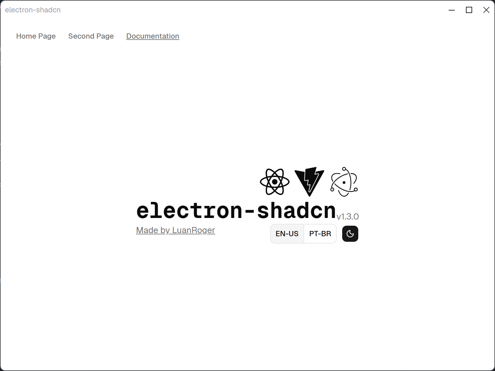

# ER-AI Trainer Studio 🚀

Aplikasi desktop berbasis Electron + React + Tailwind CSS + Shadcn UI untuk menginjeksi pengetahuan proyek kodingan Anda ke model lokal (Ollama / `er-ai`).



## Fitur Utama

- 📂 **Pilih Folder Proyek**: Memilih direktori proyek secara langsung via native folder dialog.
- 🔍 **Auto-Scan & Deteksi Stack**: Mendeteksi otomatis teknologi (`package.json`, `composer.json`, `tsconfig.json`, `tailwind`, dll.) serta memetakan pohon struktur file proyek.
- 🦙 **Integrasi Ollama Lokal**: Menghubungkan langsung ke server Ollama lokal (`http://localhost:11434`) untuk membaca daftar model yang terpasang (`er-ai:latest`, `qwen2.5-coder:3b`, `deepseek-r1:1.5b`, dll.).
- 📑 **Preset Template Kodingan Siap Pakai**:
  - Arsitektur & Konvensi Proyek
  - Clean Code & Strict Type Safety (Zero `any`)
  - Backend, Database & REST API
  - Frontend, UI/UX & Tailwind CSS
  - Testing & Bug Auditor
  - Custom Manual
- 📝 **Editor Prompt Fleksibel**: Bebas mengedit dan menambahkan instruksi khusus sebelum pelatihan/pembuatan model.
- ⚡ **1-Click Model Builder**:
  - **Latih & Simpan ke Ollama**: Mengompilasi Modelfile (dengan context `num_ctx 32768`) dan membuat model langsung ke Ollama via API.
  - **Simpan ke AGENTS.md**: Menulis aturan proyek langsung ke file `AGENTS.md` di root folder proyek Anda.
  - **Salin Modelfile**: Format modelfile siap pakai ke clipboard.

## Tech Stack

- **Framework**: Electron 43 + React 19 + TypeScript
- **Styling**: Tailwind CSS v4 + Shadcn UI (Base UI)
- **Routing & State**: TanStack Router + TanStack Query
- **IPC Architecture**: oRPC (Type-safe RPC over MessagePort)
- **Bundler & Build**: Vite 8 + Electron Forge

## Menjalankan Aplikasi

### Mode Development
```bash
# Install dependencies
pnpm install

# Jalankan aplikasi
pnpm start
```

### Packaging / Build Binary
```bash
pnpm package
```
Hasil build binary Linux x64 akan berada di folder `out/ER-AI Trainer Studio-linux-x64/`.

## Lisensi
MIT License
